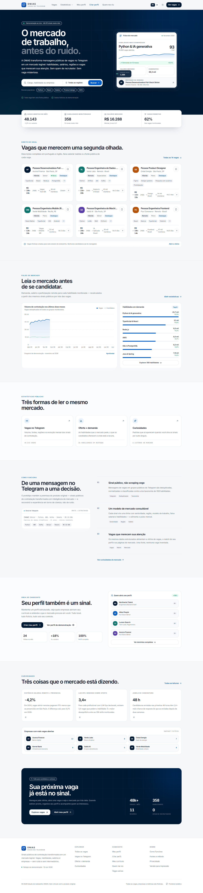
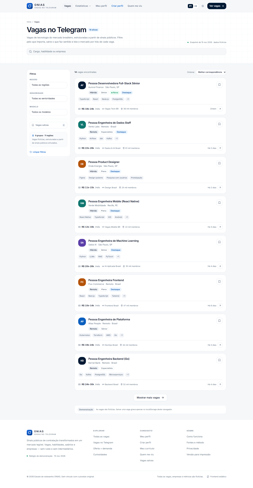

# ONIAS — Telegram job platform, redesigned

An independent, frontend-only redesign study of **ONIAS**, the Brazilian product that turns public Telegram hiring messages into a readable tech job market. This version is rebuilt as a **public job platform for candidates**: browse roles, read the market, keep a profile and see which companies opened it.

> **This is not ONIAS.** It is an unaffiliated design prototype. There is no backend, authentication, database, payment flow or email delivery. Every person, company, domain, salary, job and metric is fictional demonstration data.




## What is included

| Area | Route | Highlights |
| --- | --- | --- |
| Home | `/` | Telegram-sourced market pulse, featured roles, skill signals, hiring companies, how the pipeline works |
| Jobs | `/vagas` | 14 bilingual roles, full-text search, region/seniority/work-model filters, saved roles, sorting, mobile filter sheet |
| Job detail | `/vagas/[id]` | Full PT/EN description, responsibilities, requirements, benefits, salary, source channel and a simulated Telegram application |
| Telegram stats | `/estatisticas/telegram` | Volume, source groups, regions, 12-month trend and a transparent method section |
| Supply × demand | `/estatisticas/oferta-demanda` | Skill gap classification, scatter plot, salary and remote-share benchmarks |
| Curiosities | `/estatisticas/curiosidades` | Editorial market readings and fictional facts |
| My profile | `/perfil` | Candidate hero, KPIs, recruiter-facing profile, completion checks, privacy and blocked domains |
| Create profile | `/perfil/criar` | Three-step wizard that starts from a blank profile, with per-step validation |
| Edit profile | `/perfil/editar` | React Hook Form + Zod, repeatable experience/education/certifications, live completion feedback, localStorage persistence |
| Résumé | `/curriculo` | Print-ready A4 document, section toggles, compact mode, no upload |
| Who viewed me | `/quem-me-viu` | Monthly company domains behind a simulated email gate, visibility chart, block/unblock, timeline |

All screens ship in **light and dark themes**, in **Portuguese and English**, and adapt to 1440, 1024, 768, 390 and 360 px widths. On mobile the job filters become a bottom sheet and navigation moves into a drawer.

## Bilingual model

- **Interface:** PT/EN toggle in the header. The locale is stored in a cookie and read on the server, so the first paint is already correct and there is no hydration flash.
- **Job content:** every role is written natively in Portuguese and English — title, summary, responsibilities, requirements, benefits and company description.
- **Candidate content:** the demo profile is written by the candidate in Portuguese. UI labels and chart axes translate; the profile text stays as authored, with a short note in English mode explaining why.

## Stack

- **Next.js 15.5** App Router, server-rendered pages plus statically generated job detail routes
- **React 19.1** + **TypeScript 5**
- **Tailwind CSS 3.4** with CSS-variable design tokens
- **Radix UI** primitives and local shadcn-style components
- **Lucide** icons, **Recharts** charts, **React Hook Form**, **Zod**, **Sonner**
- **Playwright Core** for reproducible screenshots (uses locally installed Chrome/Edge)

## Run locally

```bash
npm install
npm run dev
```

Open <http://localhost:3000>. The home page is the entry point; the app opens in Portuguese by default (the cookie can be changed with the PT/EN switch).

```bash
npm run build        # production build + type check
npm run lint         # ESLint
npm run screenshots  # requires a running server (see below)
```

### Screenshots

The capture script expects a production server at <http://localhost:3000>:

```bash
npm run build
npm run start        # in one terminal
npm run screenshots  # in another
```

It drives local Chrome/Edge through `playwright-core`, disables motion for stable captures and writes a gallery of 48 images to `screenshots/`. The matrix covers 1440, 1024, 768, 390 and 360 px, dark-theme variants, the create-profile wizard, the mobile filter sheet, the unlocked “who viewed me” state and a print-media résumé. Override the target with `SCREENSHOT_BASE_URL` or the browser with `CHROME_PATH`.

## Demo behaviour

- **Fixed clock:** 15 November 2026 (`DEMO_NOW`). Month selectors and relative timestamps are anchored to it.
- **Deterministic data:** seeded generators return the same figures for the same filters.
- **Local persistence:** profile edits, saved jobs and applications live in `localStorage` under `onias.demo.v1.*`; the “who viewed me” unlock uses `sessionStorage` and lasts for one tab.
- **Create from scratch:** `/perfil/criar` builds an independent profile in three steps and replaces the demo candidate in this browser only. “Restaurar demonstração” in the editor brings the fictional profile back.
- **Simulated application:** applying opens a Telegram handoff dialog that composes a message and records the action locally. Nothing is transmitted.
- **Simulated email gate:** “Quem me viu” asks for an email before revealing corporate domains. No email is sent and no data leaves the browser.
- **Privacy by design:** visibility is company-domain level. Recruiter names are never shown, and blocked domains see the profile without contact details.
- **No dead actions:** every visible primary action either navigates, changes state or clearly states that it is a simulation.

## Project structure

```text
src/
  app/
    (site)/            Public routes, server-rendered with the locale cookie
  components/
    charts/            Localized Recharts wrappers
    i18n/              Locale provider and PT/EN toggle
    layout/            Logo
    profile/           Profile, editor, résumé and who-viewed views
    site/              Header, footer, search, job cards, jobs view, apply dialog
    ui/                Local shadcn-style primitives
  data/                Bilingual jobs, candidate profile, activity and market extras
  lib/                 Locale, formatting, market generator, validation, persistence
  types/               Shared domain types
docs/
  onias-system-analysis.md
  redesign-plan.md
screenshots/
scripts/screenshots.mjs
```

## Data and privacy

This prototype deliberately contains **no real personal data** and no integration with ONIAS infrastructure. Names, companies, emails, phone numbers, LinkedIn URLs, domains, salaries and statistics are fictional. Brazilian product conventions (BRL, CLT/PJ/BTC, DDD regions, LGPD language) are used to keep the redesign credible.

## Limitations

- No backend, authentication, database, email, file upload or real account deletion.
- Market aggregates are illustrative, not scraped from Telegram or any live source.
- The résumé is a browser print view, not a generated file.
- Applications and the who-viewed email gate are simulations and never leave the browser.
- The original product’s recruiter/management area is intentionally out of scope.

## Attribution

ONIAS is a real product; this repository is an independent redesign exercise and is not endorsed by or affiliated with it. No proprietary assets are reused.

See [`docs/onias-system-analysis.md`](docs/onias-system-analysis.md) for the product research and [`docs/redesign-plan.md`](docs/redesign-plan.md) for the design rationale.
